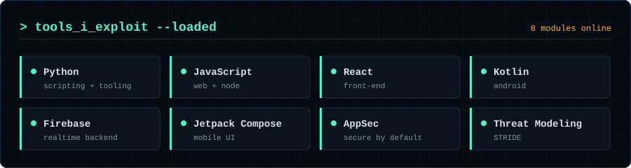
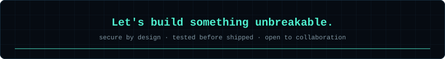

 

I'm a security-minded engineer at **Teradata**. I build full-stack and mobile apps, and I'm putting my time into two things: **application and cloud security**, and **AI systems that are tested for abuse before they ship**.

## `> active_operations`

| Rank | Operation | What it does | Status |
| :-: | --- | --- | :-: |
| **S** | [Voyantra](https://github.com/rama-itha/Voyantra) | Trip planner with live sync and shareable read-only or collaborative itineraries (React, Firebase) | `SHIPPED` |
| **S** | [Prayaas-Book-Bank](https://github.com/rama-itha/Prayaas-Book-Bank) | Android book bank with QR issue and return via ML Kit (Kotlin, Compose, Firebase) | `SHIPPED` |
| **A** | [secretscan](https://github.com/rama-itha/secretscan) | Dependency-free secrets scanner: pre-commit hook, GitHub Action and CLI (Python) | `SHIPPED` |
| **A** | [Rama-Portfolio](https://github.com/rama-itha/Rama-Portfolio) | Portfolio of full-stack and system design work | `LIVE` |
| **S+** | LLM red-team harness | Tests LLM apps for prompt injection, data leakage and jailbreaks, mapped to the OWASP Top 10 for LLM Applications | `IN PROGRESS` |
| **A** | CVE advisory RAG assistant | Ask questions about vulnerabilities and get cited answers | `PLANNED` |

[GitHub](https://github.com/rama-itha) · [LinkedIn](https://www.linkedin.com/in/rama-itha/) · [Portfolio](https://rama-itha.netlify.app/)

